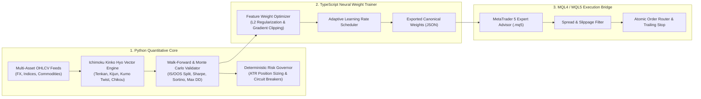

# 📈 Quant-Ichimoku-Engine — Multi-Asset Algorithmic Backtesting, Neural Weight Optimization & MQL5 Execution Bridge

[](https://www.python.org/)
[](https://www.typescriptlang.org/)
[](#mql5-low-latency-execution-bridge)
[](#continuous-integration)

> **Production-grade quantitative research, walk-forward statistical validation, and algorithmic execution framework combining Python vector/event-driven backtesting, TypeScript neural weight optimization, and MQL4/MQL5 low-latency execution bridges.**

---

## 🏛️ Architectural Overview

Quantitative trading systems frequently fail in live markets due to **look-ahead bias**, **overfitting on in-sample data**, and **execution drift** between research notebooks and MetaTrader (MQL4/MQL5) terminals.

**Quant-Ichimoku-Engine** solves this by enforcing a strict 3-layer separation of concerns:



---

## ⚡ Key Engineering Capabilities

1. **Zero Look-Ahead Ichimoku Computation (`quant_engine/ichimoku_core.py`):**
   - Computes Tenkan-sen ($9$), Kijun-sen ($26$), Senkou Span A/B ($52$ shifted $+26$), and Chikou Span ($-26$) with strict causal indexing so future bars can never leak into historical signal generation.
2. **Walk-Forward Out-of-Sample Validator (`quant_engine/walk_forward_validator.py`):**
   - Evaluates strategy robustness across rolling In-Sample (IS) and Out-of-Sample (OOS) windows, computing **Sharpe Ratio**, **Profit Factor**, **Maximum Drawdown**, and **OOS Efficiency Ratio**.
3. **Deterministic Risk & Drawdown Governor (`quant_engine/risk_governor.py`):**
   - Enforces volatility-adjusted position sizing via Average True Range ($ATR_{14}$) and hard daily/total equity circuit breakers (Prop-Firm / Hedge-Fund compliant).
4. **TypeScript Neural Feature Optimizer (`ts_optimizer/weight_clipper.ts`):**
   - Normalizes multi-timeframe signal weights with gradient clipping and activation bounding to prevent runaway weight explosion during volatile market regimes.
5. **MQL5 Execution Bridge (`mql5_bridge/IchimokuExecutionBridge.mq5`):**
   - Native MetaTrader 5 Expert Advisor executing validated signals with millisecond latency, spread guards, and atomic stop-loss enforcement.

---

## 🚀 Quickstart & Verification

```bash
git clone https://github.com/GabriMannino-pt/Quant-Ichimoku-Engine.git
cd Quant-Ichimoku-Engine
python -m unittest discover -s tests -v
```

---

## 📁 Repository Structure

```text
Quant-Ichimoku-Engine/
├── quant_engine/
│   ├── __init__.py
│   ├── ichimoku_core.py           # Causal Ichimoku Kinko Hyo & ATR indicator engine
│   ├── risk_governor.py           # Volatility-scaled sizing & drawdown circuit breakers
│   └── walk_forward_validator.py  # Rolling IS/OOS statistical stress-testing
├── ts_optimizer/
│   └── weight_clipper.ts          # TypeScript neural weight normalization & clipping
├── mql5_bridge/
│   └── IchimokuExecutionBridge.mq5 # Native MQL5 Expert Advisor execution bridge
├── tests/
│   └── test_quant_engine.py       # Deterministic unit & statistical validation suite
├── .github/workflows/ci.yml       # Automated GitHub Actions CI pipeline
├── Dockerfile                     # Reproducible containerized research environment
└── README.md
```

---

## 👨‍💻 Author
**Gabriele Mannino** — AI & Full-Stack Software Engineer | FinTech & Quantitative Systems Architect  
- LinkedIn: [linkedin.com/in/gabriele-mannino-dev](https://www.linkedin.com/in/gabriele-mannino-dev)
- GitHub: [@GabriMannino-pt](https://github.com/GabriMannino-pt)
